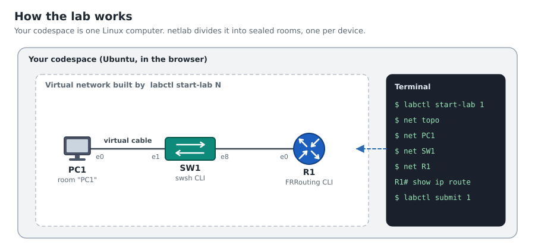

# 00 · Getting started with the CCNA Lab Kit

Welcome. In this course you will build, break and repair real networks: routers that run real routing protocols, switches that really tag VLANs, PCs that really send pings. All of it runs **in your web browser**, so you don't need to install anything and any laptop will do.



> **Analogy: one office floor, many sealed rooms.** Your codespace is a single Linux computer in the cloud. When you start a lab, the kit puts up walls to divide that computer into sealed rooms, one per device (PC1, SW1, R1...). Each room has its own network cards, addresses and routing table, and the rooms are joined by virtual cables. From inside PC1, the rest of the codespace simply doesn't exist: it sees only its own cable.

| Device | What runs inside | How you talk to it | Feels like |
|---|---|---|---|
| Router (R1, R2...) | FRRouting, a real routing suite used by ISPs and data centres | `net R1` | Cisco IOS: `configure terminal`, `router ospf`, `show ip route` |
| Switch (SW1, SW2) | A Linux bridge with 802.1Q VLANs | `net SW1` | Cisco IOS: `vlan 10`, `switchport mode access`, `show vlan brief` |
| PC / server | A plain Linux host with one network card, `e0` | `net PC1` | A Linux PC: `ip addr`, `ping`, `traceroute` |

The router and switch commands are close to Cisco's, but not identical. Every lab has a **"Cisco IOS vs this lab"** box, and [`docs/ios-vs-lab-cheatsheet.md`](../docs/ios-vs-lab-cheatsheet.md) lists every difference in one place. For the exam, learn the Cisco form. The lab teaches you what the commands *do*.

---

## 1. One-time setup (about 20 minutes)

### 1.1 Get a GitHub account
Sign up free at [github.com](https://github.com). Use a username you're happy for your lecturer to see. A free account includes Codespaces hours every month, which is enough for this course if you **stop your codespace when you finish** (section 4).

> If you're a student, apply for the free **GitHub Student Developer Pack** (education.github.com). It raises your monthly Codespaces allowance.

### 1.2 Make your own copy of the lab kit
1. Open the template: **github.com/Kofi-dba/ccna-lab-kit**
2. Click the green **Use this template** button, then **Create a new repository**.
   - ⚠️ Do **not** choose "Open in a codespace" from the template. That gives you a codespace that isn't linked to any repository, so `labctl submit` will have nowhere to upload your work.
3. **Owner:** you. **Repository name:** `ccna-labs-yourname` (for example `ccna-labs-ama-mensah`).
   - The name **must contain `ccna`**, or your lecturer's class list won't find it.
4. Choose **Private**, then click **Create repository**.

### 1.3 Let your lecturer see your work
In your new repository, go to **Settings → Collaborators → Add people**, type **`Kofi-dba`** and send the invitation.

> **Analogy:** your repository is a locked locker that only you can open. Adding your lecturer as a collaborator gives him a key, so he can collect your evidence files without you emailing anything.

### 1.4 Open your codespace
In **your** repository (not the template), click **Code → Codespaces → Create codespace on main**.

The first build takes about 5 minutes while it installs FRRouting and the other tools. Later starts take under a minute. When it's ready, this page opens on the left and a terminal appears at the bottom.

### 1.5 Health check (homework before Lab 1)
In the terminal, type:

```bash
labctl doctor
```

**What you should see:** a list of green ✔ ending with *"All good"*. The most important line is *"Virtual cables work (test ping between two virtual devices succeeded)"*.

📸 **Take a screenshot and send it to your lecturer at least 48 hours before Lab 1.** If you see any red ✘, check section 5.

---

## 2. The routine for every lab

```bash
labctl hello 3          # 1. sign the attendance book for lab 3 (do this first, every time)
labctl start-lab 3      # 2. build lab 3's network (about 10-20 seconds)
net topo                # 3. look at the map
# ... follow the lab sheet: labs/lab03-....md ...
labctl check 3          # 4. see your score, as often as you like
labctl submit 3         # 5. upload your work. You can submit again; the last upload counts
```

> **Analogy:** `hello` is signing the visitors' book at the door. `check` is asking the examiner "how am I doing?". `submit` is handing your script in at the desk.

Your answers to each lab's questions go in **`my-work/answers/labNN.md`**, which is created for you when you start the lab. Open it from the Explorer on the left.

---

## 3. Getting around a lab

| You want to... | Type | Leave with |
|---|---|---|
| See the map | `net topo` | - |
| See which devices are running | `net list` | - |
| Work on a router | `net R1` | `exit` (from `R1#`) |
| Work on a switch | `net SW1` | `exit` (from `SW1>` or `SW1#`) |
| Work on a PC | `net PC1` | `exit` |
| Run one command and come straight back | `net PC1 ping -c 3 10.0.0.12`<br>`net R1 show ip route`<br>`net SW1 show vlan brief` | - |
| Watch frames on a cable | `net capture PC3 e0` | `Ctrl + C` |

**Prompts tell you where you are.** Get into the habit of reading them before every command:

```text
@yourname ➜ /workspaces/ccna-labs-yourname $    the codespace itself (labctl and net live here)
PC1:~$                                          inside PC1
SW1>   SW1#   SW1(config)#   SW1(config-if)#    inside SW1: user, privileged, global config, interface config
R1#    R1(config)#   R1(config-router)#         inside R1
```

> **Tip:** Cisco-style devices accept abbreviations: `conf t`, `sh ip ro`, `int e1`. Press **Tab** to complete a word and type **`?`** to see what can come next. Abbreviations must be unambiguous: on a switch, `s` could mean `shutdown` or `switchport`, so it is rejected.

---

## 4. Saving, stopping and coming back

- **Save as you go:** `labctl save` stores every device's configuration in `my-work/saved/`. `labctl check` and `labctl submit` save automatically.
- **Codespaces stop themselves** after 30 minutes without activity. When you reopen one, the lab is rebuilt and your last *saved* work is put back. Anything you changed after your last save is lost, just like a real router losing unsaved changes in a power cut. To bring a lab back by hand, run `labctl resume`.
- **Stop your codespace when you finish**, to save your free hours: github.com → your profile picture → **Your codespaces** → **⋯** → **Stop codespace**.
- **Never delete your codespace** before you have run `labctl submit`.
- **Starting again from scratch:** `labctl start-lab N` always builds a clean network. Your saved work stays in `my-work/saved/` until you save again.

---

## 5. Troubleshooting

| Symptom | Likely cause | Fix |
|---|---|---|
| `labctl: command not found` | The setup script didn't finish | `bash .devcontainer/post-create.sh`, then open a new terminal |
| doctor: *"Cannot build virtual networks"* | The codespace was built from the wrong image | `Ctrl+Shift+P` → **Codespaces: Rebuild Container**. If it still fails, tell your lecturer |
| doctor: *"You are inside the TEMPLATE"* | You opened the codespace from the template | Do step 1.2 again and open a codespace from **your** repository |
| doctor: *"Repo name must contain ccna"* | Your repository has another name | Repository **Settings → General → Repository name**: rename it, e.g. `ccna-labs-ama` |
| `submit`: *"not linked to a repository"* | Same as above | Source Control panel → **Publish Branch** → private repository with `ccna` in the name |
| `submit`: *"git-lfs: command not found"* | Leftover Git hooks | `rm -f .git/hooks/pre-push .git/hooks/post-checkout .git/hooks/post-commit .git/hooks/post-merge` |
| `net: no lab is running` | The codespace restarted | `labctl resume` (or `labctl start-lab N` for a clean start) |
| A device shows `MISSING` in `net list` | Something crashed | `labctl save`, then `labctl resume` |
| You broke everything | That's how you learn! | `labctl start-lab N` gives you a fresh network |

Still stuck? Run `labctl doctor`, take a screenshot and send it with a one-line description of what you were doing.
