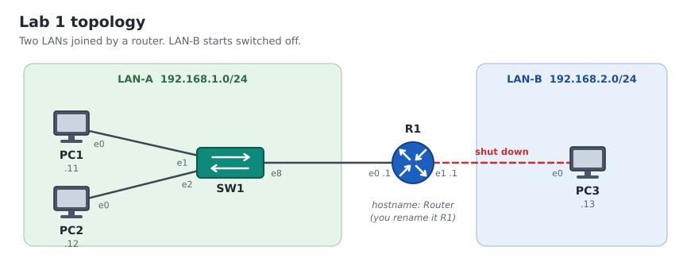

# Lab 1 · Meet your lab network and the device CLI

| | |
|---|---|
| **CCNA 200-301 v1.1 topics** | 1.1 Network components (routers, L2 switches, endpoints) · 1.2 Topology architectures · 1.6 IPv4 addressing (first look) |
| **Time** | 90 minutes |
| **You will be able to** | move between devices, read prompts and CLI modes, check interfaces and routing tables, bring an interface up and save a configuration |

```bash
labctl hello 1
labctl start-lab 1
```



| Device | Interface | Address | Gateway |
|---|---|---|---|
| PC1 | e0 | 192.168.1.11/24 | 192.168.1.1 |
| PC2 | e0 | 192.168.1.12/24 | 192.168.1.1 |
| R1 | e0 | 192.168.1.1/24 | - |
| R1 | e1 | 192.168.2.1/24 (**shut down**) | - |
| PC3 | e0 | 192.168.2.13/24 | 192.168.2.1 |

---

## Part A · Look around

> **Know-how card: topology**
> - **What it is:** the map of which device connects to which, through which port.
> - **When you use it:** before you touch anything. Every troubleshooting job starts with the map.
> - **How:** `net topo` draws it. `net list` shows which devices are running.
> - **Analogy:** before fixing a building's plumbing, you look at the pipe drawing, not at the taps.

```bash
net topo
net list
```

**What you should see:** five devices, PC1, PC2, SW1, R1 and PC3, all `running`.

---

## Part B · Visit a PC

> **Know-how card: IP address, mask and default gateway**
> - **What it is:** the IP address says *who* a host is. The mask (`/24`) says *which addresses are neighbours* on the same LAN. The default gateway is *the door out* for every other destination.
> - **When you use it:** every time a host can't reach something, check these three first.
> - **How:** on Linux, `ip addr` and `ip route`. On Windows, `ipconfig` (this lab's PCs also accept `ipconfig`).
> - **Analogy:** your house number (IP), your street (subnet) and the junction at the end of the street (gateway). To visit a neighbour you walk along the street. To go to another town you must pass the junction.

```bash
net PC1
```

You are now **inside PC1**: the prompt is `PC1:~$`. Run:

```bash
ip addr show e0          # address and mask
ip route                 # "default via 192.168.1.1" = the gateway
ping -c 3 192.168.1.12   # PC2: same street
ping -c 3 192.168.1.1    # R1: the junction
ping -c 3 192.168.2.13   # PC3: the other town
exit
```

**What you should see:** the pings to PC2 and R1 get replies (`64 bytes from ...`). The ping to PC3 ends with `100% packet loss`. Keep that in mind: you'll fix it in Part D.

---

## Part C · Visit the switch

> **Know-how card: CLI modes**
> - **What it is:** Cisco-style devices have layers of access, like the floors of a bank.
>
>   | Prompt | Mode | What you can do |
>   |---|---|---|
>   | `SW1>` | user EXEC | look at a few things |
>   | `SW1#` | privileged EXEC | look at everything, save, clear |
>   | `SW1(config)#` | global configuration | change device-wide settings |
>   | `SW1(config-if)#` | interface configuration | change one port |
> - **How:** `enable` goes up from `>` to `#`. `configure terminal` goes from `#` to `(config)#`. `exit` goes back one level. `end` jumps straight back to `#`.
> - **Analogy:** the banking hall (`>`), the back office (`#`), the vault (`config`) and a single safe-deposit box inside the vault (`config-if`).

```bash
net SW1
```

```text
SW1> enable
SW1# show version
SW1# show interfaces status
SW1# show mac address-table
SW1# show running-config
SW1# exit
```

**What you should see:**
- `show interfaces status` lists e1, e2 and e8 as `connected`, all in VLAN `1`.
- `show mac address-table` lists MAC addresses on e1, e2 and e8: the switch learned them from your pings in Part B. (Lab 3 is all about this table.)

Try `sh int stat` and `sh mac add`. Abbreviations work. Then type `show ?` to list the possible next words.

---

## Part D · Visit the router and fix it

> **Know-how card: interface status and `no shutdown`**
> - **What it is:** an interface can be administratively **down** (switched off in the config) or **up**. On real Cisco routers, every interface starts shut down. You must say `no shutdown`.
> - **When you use it:** a link with lights off, or an interface showing `down` or `administratively down`.
> - **How:** `interface e1` → `no shutdown`. Check with `show interface brief` (Cisco: `show ip interface brief`).
> - **Analogy:** a door can be locked from the inside even when the corridor behind it is fine. `no shutdown` unlocks the door.

```bash
net R1
```

Notice the prompt is `Router#`. This device is still called "Router". FRRouting starts you directly in privileged mode, so you don't need `enable`.

```text
Router# show interface brief
Router# show ip route
```

**What you should see:**
- `e0` is `up` with 192.168.1.1/24. `e1` is **`down`**.
- The routing table only has `C>* 192.168.1.0/24 is directly connected, e0`. R1 doesn't know about 192.168.2.0/24 because its door to that network is locked. That's why PC1 couldn't reach PC3.

Now fix it and give the router its proper name:

```text
Router# configure terminal
Router(config)# hostname R1
R1(config)# interface e1
R1(config-if)# no shutdown
R1(config-if)# end
R1# show interface brief
R1# show ip route
```

**What you should see:** `e1` is now `up`, and a second connected route appears: `C>* 192.168.2.0/24 is directly connected, e1`.

> **Reading `show ip route`:** `C` = connected, `S` = static, `O` = OSPF, `K` = kernel. `>` marks the route the router chose and `*` means it's installed for forwarding. Cisco adds `L` (local /32) routes, which FRRouting doesn't show.

Finally, **save**. The running configuration lives in memory, so if the router restarts, unsaved changes are gone.

```text
R1# write memory
R1# exit
```

> **Analogy:** `running-config` is what's written on the whiteboard. `startup-config` is what's in the notebook. `write memory` (Cisco also: `copy running-config startup-config`) copies the whiteboard into the notebook before the cleaner comes.

---

## Part E · Test end to end

```bash
net PC1 ping -c 3 192.168.2.13
net PC1 traceroute -n 192.168.2.13
net PC2 ping -c 3 192.168.2.13
```

**What you should see:** replies from PC3. The traceroute shows two hops: `192.168.1.1` (R1), then `192.168.2.13` (PC3).

---

## Cisco IOS vs this lab

| Task | Cisco IOS | This lab (FRRouting) |
|---|---|---|
| Interface names | `GigabitEthernet0/0`, `g0/0` | `e0`, `e1` |
| Interface summary | `show ip interface brief` | `show interface brief` |
| Set an address | `ip address 192.168.2.1 255.255.255.0` | `ip address 192.168.2.1/24` |
| Interfaces at power-on | shut down | up, unless the lab shuts them (like e1 here) |
| Save | `copy running-config startup-config` or `write memory` | `write memory` |
| Router login | starts at `Router>`, needs `enable` | starts at `Router#` |

---

## Questions

Write your answers in `my-work/answers/lab01.md`.

**Q1.** Which device in this topology works at Layer 3, and which at Layer 2? Give one job each one does.

**Q2.** Before Part D, PC1 could ping R1 (192.168.1.1) but not PC3. Using what you saw in `show ip route`, explain why.

**Q3.** What is the difference between the prompts `R1#`, `R1(config)#` and `R1(config-if)#`? Which command takes you from the third straight back to the first?

**Q4.** What would happen to your `hostname R1` change if the router restarted *before* you typed `write memory`? Why?

**Q5.** In `show mac address-table` on SW1, which port had R1's MAC address? How did the switch know?

**Q6.** The traceroute from PC1 to PC3 showed two hops. Name the device at each hop.

---

## Key terms

| Term | Meaning |
|---|---|
| Endpoint | A device that sends or receives data (PC, server, phone) |
| Router | Joins different IP networks and chooses paths between them (Layer 3) |
| Switch | Joins devices in the same LAN using MAC addresses (Layer 2) |
| Default gateway | The router address a host sends to for any non-local destination |
| Connected route (`C`) | A route the router knows because one of its own interfaces is on that network |
| Running / startup config | The live configuration in memory / the saved copy loaded at boot |

## Finish

```bash
labctl check 1
labctl submit 1
```
