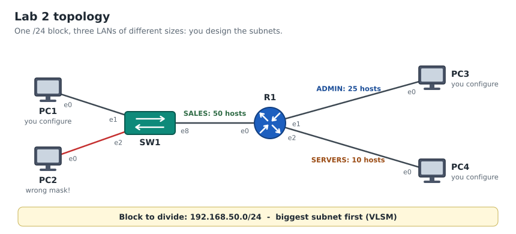
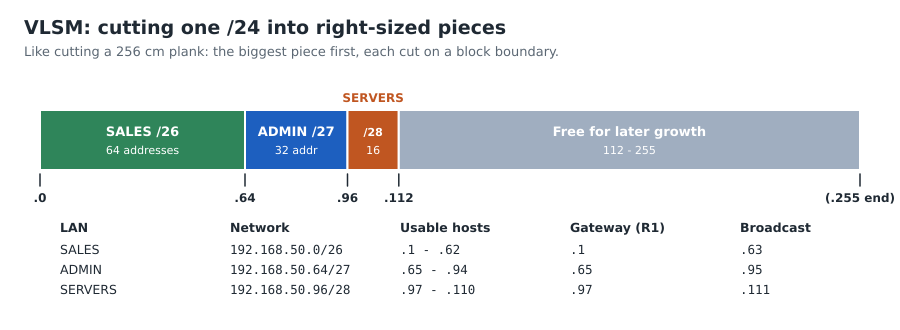

# Lab 2 · IPv4 addressing and VLSM subnetting

| | |
|---|---|
| **CCNA 200-301 v1.1 topics** | 1.6 Configure and verify IPv4 addressing and subnetting · 1.7 Private IPv4 addressing · 1.10 Verify IP parameters for client OS |
| **Time** | 2 hours |
| **You will be able to** | design subnets of different sizes from one block (VLSM), address routers and hosts, and spot a wrong subnet mask from its symptoms |

```bash
labctl hello 2
labctl start-lab 2
```



**The brief.** The Faculty has been given **192.168.50.0/24**, a *private* block (RFC 1918), and needs three LANs:

| LAN | Router port | Hosts needed |
|---|---|---|
| SALES | R1 e0 (via SW1) | 50 |
| ADMIN | R1 e1 | 25 |
| SERVERS | R1 e2 | 10 |

House rules: **the router always takes the first usable address** of each subnet. The PCs use these host numbers: PC1 `.10`, PC2 `.20`, PC3 `.70`, PC4 `.100`.

---

## Part A · Design on paper first

> **Know-how card: subnet size**
> - **What it is:** a prefix `/n` leaves `32 − n` host bits. Usable hosts = 2^(32−n) − 2, because the first address is the *network* address and the last is the *broadcast* address.
> - **When you use it:** whenever you're asked "how many hosts fit?" or "which mask do I need?".
> - **How:** find the smallest block that fits the hosts:
>
>   | Prefix | Mask | Block size | Usable hosts |
>   |---|---|---|---|
>   | /24 | 255.255.255.0 | 256 | 254 |
>   | /25 | 255.255.255.128 | 128 | 126 |
>   | /26 | 255.255.255.192 | 64 | 62 |
>   | /27 | 255.255.255.224 | 32 | 30 |
>   | /28 | 255.255.255.240 | 16 | 14 |
>   | /29 | 255.255.255.248 | 8 | 6 |
>   | /30 | 255.255.255.252 | 4 | 2 |
> - **Analogy:** plots of land on a street. The first plot is the street sign (network address), the last is the community notice board (broadcast). Only the plots in between can have houses.

> **Know-how card: VLSM (Variable Length Subnet Masking)**
> - **What it is:** using *different* prefix lengths inside one block, so each LAN gets a right-sized piece instead of all getting the biggest size.
> - **When you use it:** almost always in real networks, because addresses are precious.
> - **How:** sort the LANs **biggest first**. Give each one the next free block of the right size. A block must start on a multiple of its own size.
> - **Analogy:** cutting a plank into shelves. Cut the longest shelf first and the short ones fit into what's left. Cut the short ones first and you end up with offcuts too small to use.



**Your task:** in `my-work/answers/lab02.md`, fill in the design table **before** looking at the picture above too closely. Then compare.

| LAN | Hosts | Prefix | Network | First usable (R1) | Last usable | Broadcast |
|---|---|---|---|---|---|---|
| SALES | 50 | | | | | |
| ADMIN | 25 | | | | | |
| SERVERS | 10 | | | | | |

---

## Part B · Address the router

```bash
net R1
```

```text
R1# configure terminal
R1(config)# interface e0
R1(config-if)# ip address 192.168.50.1/26
R1(config-if)# interface e1
R1(config-if)# ip address 192.168.50.65/27
R1(config-if)# interface e2
R1(config-if)# ip address 192.168.50.97/28
R1(config-if)# end
R1# show interface brief
R1# show ip route
R1# write memory
R1# exit
```

**What you should see:** three `C` (connected) routes: 192.168.50.0/26, 192.168.50.64/27 and 192.168.50.96/28. Notice that you typed *host* addresses on the interfaces, but the router worked out the *network* addresses by itself, using the mask.

> **Cisco IOS form:** `ip address 192.168.50.65 255.255.255.224`. Practise converting: /27 = 255.255.255.224.

---

## Part C · Address the hosts

> **Know-how card: configuring a Linux host**
> - **How:**
>   ```bash
>   ip addr add 192.168.50.10/26 dev e0        # address + mask
>   ip route add default via 192.168.50.1      # default gateway
>   ip addr del 192.168.50.10/26 dev e0        # remove a wrong address
>   ```
> - **Windows equivalent:** Network settings → IPv4 → address, subnet mask, default gateway. Check with `ipconfig`.

**PC1, PC3 and PC4 have no address yet. Configure them:**

```bash
net PC1
ip addr add 192.168.50.10/26 dev e0
ip route add default via 192.168.50.1
ip addr ; ip route
exit
```

Now do the same for **PC3** (`.70`, ADMIN) and **PC4** (`.100`, SERVERS), using your design table for the mask and gateway.

---

## Part D · The PC with the wrong mask

PC2 was set up by someone in a hurry. Investigate before you fix anything:

```bash
net PC2 ip addr show e0
net PC2 ping -c 2 192.168.50.10      # PC1, same LAN
net PC2 ping -c 2 192.168.50.70      # PC3, ADMIN LAN
net PC2 ip neigh                     # PC2's ARP table
```

**What you should see:** PC2 is `192.168.50.20/24`. It can reach PC1, but **not** PC3. Its ARP table shows `192.168.50.70 ... FAILED` or `INCOMPLETE`.

**Why?** With a /24 mask, PC2 believes *every* 192.168.50.x address is on its own street. So instead of sending traffic for .70 to the gateway, it shouts an ARP broadcast on the SALES LAN asking "who has .70?". Nobody on SALES answers, because PC3 lives on another street.

> **Analogy:** someone with an out-of-date map thinks the next town is just another house on their road. They walk up and down the street knocking on doors, and never think to take the junction.

Fix it:

```bash
net PC2
ip addr del 192.168.50.20/24 dev e0
ip addr add 192.168.50.20/26 dev e0
ip route replace default via 192.168.50.1   # removing the last address also removes the route; replace puts it back
ping -c 3 192.168.50.70
exit
```

---

## Part E · Prove it works

```bash
net PC1 ping -c 2 192.168.50.70
net PC1 ping -c 2 192.168.50.100
net PC3 ping -c 2 192.168.50.100
net PC4 traceroute -n 192.168.50.20
```

**What you should see:** every ping gets replies. The traceroute goes through `192.168.50.97` (R1's SERVERS interface) before reaching PC2.

---

## Cisco IOS vs this lab

| Task | Cisco IOS | This lab |
|---|---|---|
| Router interface address | `ip address 192.168.50.65 255.255.255.224` | `ip address 192.168.50.65/27` |
| Host IP settings (Windows) | `ipconfig /all` | `ip addr`, `ip route` (or `ipconfig`) |
| ARP table | `show ip arp` (router), `arp -a` (Windows) | `ip neigh` |

---

## Questions

Write your answers in `my-work/answers/lab02.md`.

**Q1.** Complete the design table in Part A.

**Q2.** Why did we give SALES its subnet first? What goes wrong if SERVERS (/28) takes 192.168.50.0/28 first and SALES comes after it?

**Q3.** How many usable hosts does a /27 give? Show the calculation.

**Q4.** Is 192.168.50.64 a valid host address in this design? What about 192.168.50.95? Explain.

**Q5.** PC2 had a /24 mask. Explain, step by step, what PC2 did when you asked it to ping PC3, and why it failed.

**Q6.** The ADMIN LAN might grow to 40 hosts next year. Will /27 still be enough? Which prefix would it need, and could it still fit in the free space after .112?

**Q7.** Name the three private IPv4 ranges (RFC 1918) with their prefixes.

**Q8.** Two routers are joined by a point-to-point link that needs exactly 2 addresses. Which prefix wastes the fewest addresses?

---

## Key terms

| Term | Meaning |
|---|---|
| Network address | The first address of a subnet; identifies the subnet itself |
| Broadcast address | The last address of a subnet; reaches every host on it |
| Prefix length / mask | How many bits belong to the network (`/26` = 255.255.255.192) |
| VLSM | Different mask lengths inside one address block |
| RFC 1918 | The private ranges: 10.0.0.0/8, 172.16.0.0/12, 192.168.0.0/16 |
| ARP | Finds the MAC address for an IP on the local subnet |

## Finish

```bash
labctl check 2
labctl submit 2
```
