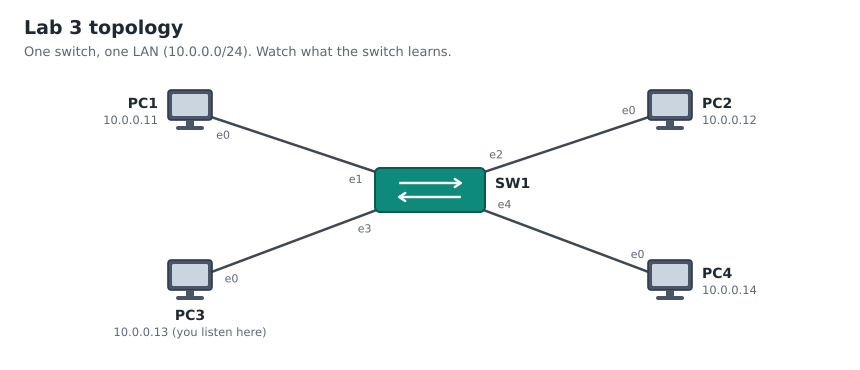
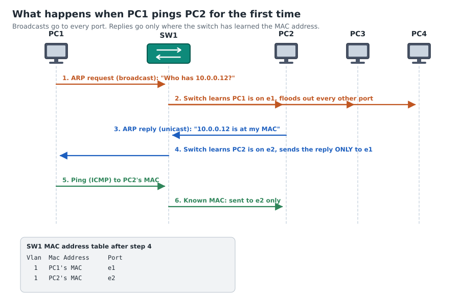

# Lab 3 · How a switch learns: MAC tables, ARP and flooding

| | |
|---|---|
| **CCNA 200-301 v1.1 topics** | 1.13 Switching concepts: MAC learning and aging, frame switching, frame flooding, MAC address table · 1.1.b L2 switches |
| **Time** | 90 minutes |
| **You will be able to** | predict where a switch sends each frame, read a MAC address table, capture frames and recognise ARP, broadcasts and unknown-unicast flooding |

```bash
labctl hello 3
labctl start-lab 3
```



All four PCs are in one LAN, 10.0.0.0/24, plugged into SW1 ports e1 to e4.

You'll need **two terminals side by side**. Click the **split** icon (⧉) at the top right of the terminal panel, or press `Ctrl+Shift+5`. Call them **T1** (left) and **T2** (right).

---

## The big idea



> **Know-how card: the MAC address table (CAM table)**
> - **What it is:** a switch's list of *"MAC address X lives behind port Y, in VLAN Z"*.
> - **How it's built:** the switch reads the **source** MAC of every frame that arrives and writes down the port it came in on (*learning*). Entries are forgotten after a period of silence (*aging*, 300 s by default).
> - **How it's used:** for each frame, the switch looks up the **destination** MAC:
>   - **known** → send it out of that one port only (*forwarding/filtering*)
>   - **unknown**, or the broadcast `ff:ff:ff:ff:ff:ff` → send it out of **every other port** in the VLAN (*flooding*)
> - **Analogy:** a new receptionist at a hostel. Every time a guest walks past the desk, she notes which room they came from. When a letter arrives for a guest she's seen, she takes it to their room. For a guest she doesn't know, she pins it on the board where everyone can see it.

> **Know-how card: ARP**
> - **What it is:** *Address Resolution Protocol*. It turns *"I want to reach 10.0.0.12"* (Layer 3) into *"send the frame to MAC 3a:…"* (Layer 2).
> - **How it works:** the request *"Who has 10.0.0.12? Tell 10.0.0.11"* is a **broadcast**. The reply *"10.0.0.12 is at 3a:…"* is **unicast**, straight back to the asker.
> - **Analogy:** shouting a name across the room (broadcast). Only that person walks over and answers you quietly (unicast).

---

## Part A · Start with empty tables

```bash
net PC1 ip neigh flush all          # T1: PC1 forgets every MAC it knew
net PC2 ip neigh flush all
net SW1
```

```text
SW1> enable
SW1# clear mac address-table dynamic
SW1# show mac address-table
SW1# exit
```

**What you should see:** `Total Mac Addresses for this criterion: 0`.

Write down each PC's MAC address. You'll need them in Part C:

```bash
for p in PC1 PC2 PC3 PC4; do echo -n "$p "; net $p cat /sys/class/net/e0/address; done
```

---

## Part B · Catch an ARP broadcast

In **T2**, start listening on PC3, a bystander:

```bash
net capture PC3 e0 lab03-arp
```

In **T1**, make PC1 ping PC2:

```bash
net PC1 ping -c 3 10.0.0.12
```

Back in **T2**, wait 3 seconds, then press `Ctrl+C`.

**What you should see in T2** (MAC addresses will differ):

```text
... 3a:11:..:..  > ff:ff:ff:ff:ff:ff, ethertype ARP (0x0806), length 42: Request who-has 10.0.0.12 tell 10.0.0.11, length 28
```

PC3 saw the **ARP request**, because it was a broadcast and the switch flooded it. PC3 did **not** see the ARP reply or any of the pings: once the switch had learned both MAC addresses, it delivered those frames only to e1 and e2.

> The capture is saved as `my-work/captures/lab03-arp.pcap`. The marker reads it, so don't delete it.

---

## Part C · Read what the switch learned

```bash
net SW1 show mac address-table
net PC1 ip neigh
```

**What you should see:**

```text
Vlan    Mac Address       Type        Ports
----    -----------       --------    -----
   1    3a11.xxxx.xxxx    DYNAMIC     e1
   1    5e22.xxxx.xxxx    DYNAMIC     e2
```

Cisco writes MAC addresses as three groups of four hex digits (`3a11.2233.4455`). Linux writes six pairs (`3a:11:22:33:44:55`). They're the same 48 bits. Match each entry against the list you wrote in Part A.

PC1's ARP table (`ip neigh`) now holds `10.0.0.12 ... lladdr <PC2's MAC>`. So two tables were filled by one ping: the **switch's** MAC table (MAC → port) and **PC1's** ARP table (IP → MAC).

---

## Part D · Unknown-unicast flooding

Now a trick. PC1 still *remembers* PC2's MAC address (ARP table), but we'll make the switch *forget* where PC2 is.

In **T1**, make sure PC1's memory is fresh:

```bash
net PC1 ping -c 1 10.0.0.12
```

In **T2**, start a new capture on the bystander:

```bash
net capture PC3 e0 lab03-flood
```

In **T1**, wipe the switch's table and ping straight away:

```bash
net SW1 clear mac address-table dynamic
net PC1 ping -c 3 10.0.0.12
```

Stop **T2** with `Ctrl+C`.

**What you should see in T2:** an `ICMP echo request` from 10.0.0.11 to 10.0.0.12 arriving at **PC3**. That frame was addressed to PC2's MAC, not to PC3 and not to broadcast, yet PC3 received it. That's **unknown-unicast flooding**: the switch didn't know where PC2's MAC was, so it flooded the frame. PC2's reply taught the switch where PC2 lives, and the next pings were forwarded normally.

PC3's network card checks the destination MAC, sees it isn't for PC3, and quietly throws the frame away. But a capture tool sees it, and so would an attacker. That's one reason switches beat hubs (which flood *everything*) and one reason MAC-table attacks exist.

---

## Part E · Aging

```text
net SW1
SW1> enable
SW1# configure terminal
SW1(config)# mac address-table aging-time 30
SW1(config)# end
SW1# show mac address-table aging-time
SW1# exit
```

```bash
net PC4 ping -c 2 10.0.0.13          # PC4 talks to PC3
net SW1 show mac address-table       # entries for e3 and e4
sleep 40
net SW1 show mac address-table       # gone again
```

**What you should see:** the e3 and e4 entries appear, then vanish after 30 seconds of silence. Leave the aging time at 30: the marker checks it.

---

## Cisco IOS vs this lab

| Task | Cisco IOS | This lab |
|---|---|---|
| MAC table | `show mac address-table` | same |
| Clear learned entries | `clear mac address-table dynamic` | same |
| Aging time | `mac address-table aging-time 30` | same |
| PC ARP table | `arp -a` (Windows) | `ip neigh` |
| Capture frames | Wireshark / SPAN port | `net capture NODE IFACE NAME` (tcpdump) |

> You can open the `.pcap` files from `my-work/captures/` in Wireshark on your own computer: right-click the file → **Download**.

---

## Questions

Write your answers in `my-work/answers/lab03.md`.

**Q1.** In Part B, which field of the ARP request frame made the switch send it to every port?

**Q2.** Why did PC3 see the ARP request but not the ARP reply?

**Q3.** A switch learns from the ______ MAC address of a frame and forwards using the ______ MAC address. Fill in the blanks.

**Q4.** Explain unknown-unicast flooding in your own words, using what you captured in Part D.

**Q5.** What is the difference between PC1's ARP table and SW1's MAC address table? Give the two columns that matter in each.

**Q6.** Why does a switch forget MAC addresses after a while (aging)? Give a real situation where an entry that never expired would cause trouble.

**Q7.** A hub would have sent every frame in Parts B to D to PC3. Give two disadvantages of that.

---

## Key terms

| Term | Meaning |
|---|---|
| MAC address | 48-bit Layer 2 address burned into a network card |
| MAC address table | Switch table of MAC → port (and VLAN) |
| Learning | Recording a frame's source MAC against its arrival port |
| Flooding | Sending a frame out of all ports except the one it came in on |
| Broadcast | Destination `ff:ff:ff:ff:ff:ff`: every host on the LAN |
| Unknown unicast | A frame to one MAC that the switch hasn't learned yet |
| Aging | Removing entries that have been silent for the aging time |

## Finish

```bash
labctl check 3
labctl submit 3
```
