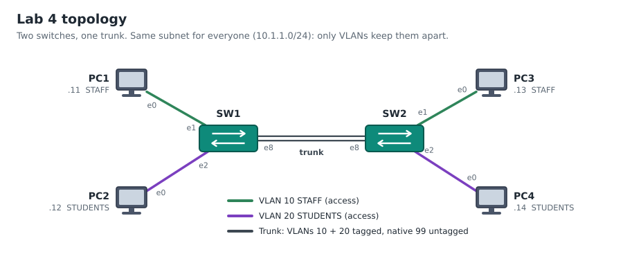
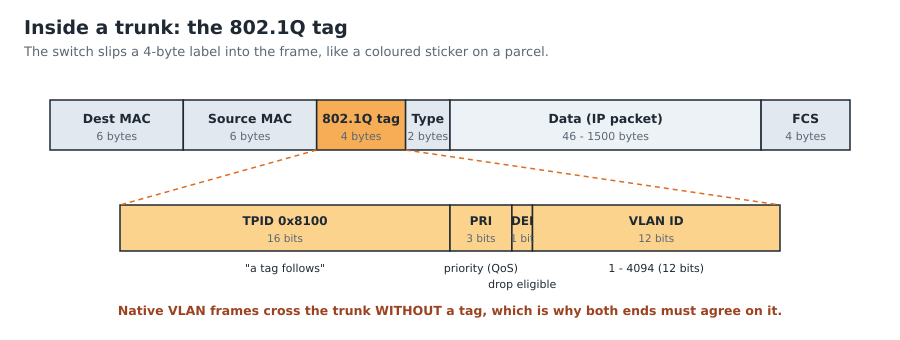

# Lab 4 · VLANs and 802.1Q trunks

| | |
|---|---|
| **CCNA 200-301 v1.1 topics** | 2.1 Configure and verify VLANs (access ports, data VLANs, default VLAN, connectivity) · 2.2 Configure and verify trunk ports (802.1Q, native VLAN) |
| **Time** | 2 hours |
| **You will be able to** | create and name VLANs, assign access ports, build a trunk with an allowed list and a native VLAN, and prove that VLANs separate traffic |

```bash
labctl hello 4
labctl start-lab 4
```



| PC | Switch port | VLAN | Address |
|---|---|---|---|
| PC1 | SW1 e1 | 10 STAFF | 10.1.1.11/24 |
| PC2 | SW1 e2 | 20 STUDENTS | 10.1.1.12/24 |
| PC3 | SW2 e1 | 10 STAFF | 10.1.1.13/24 |
| PC4 | SW2 e2 | 20 STUDENTS | 10.1.1.14/24 |
| trunk | SW1 e8 ↔ SW2 e8 | 10, 20 + native 99 | - |

> ⚠️ **On purpose, all four PCs are in the same subnet.** In real life each VLAN gets its own subnet (you'll do that in Lab 6). Here it proves a point: if PC1 can't reach PC2 even though their IP addresses are "neighbours", the only thing stopping them is the VLAN.

---

## Part A · Before VLANs

```bash
net PC1 ping -c 2 10.1.1.12
net PC1 ping -c 2 10.1.1.14
net SW1 show vlan brief
```

**What you should see:** both pings work. Every port is in **VLAN 1** (the default VLAN), so it's one big LAN where staff and students can see each other's traffic.

> **Know-how card: VLAN**
> - **What it is:** a *Virtual LAN*, a group of switch ports that behave as if they were on their own separate switch. Broadcasts and frames never cross from one VLAN to another inside a switch.
> - **When you use it:** to separate groups (staff, students, guests, phones, cameras) for security and to keep broadcasts small, without buying a switch per group.
> - **How:** create the VLAN (`vlan 10`, `name STAFF`), then put access ports in it (`switchport access vlan 10`).
> - **Analogy:** one office floor divided by glass walls. Everyone shares the building's wiring, but people can only talk to colleagues inside their own walls.

---

## Part B · Create VLANs and access ports on SW1

```bash
net SW1
```

```text
SW1> enable
SW1# configure terminal
SW1(config)# vlan 10
SW1(config-vlan)# name STAFF
SW1(config-vlan)# vlan 20
SW1(config-vlan)# name STUDENTS
SW1(config-vlan)# vlan 99
SW1(config-vlan)# name NATIVE
SW1(config-vlan)# exit
SW1(config)# interface e1
SW1(config-if)# switchport mode access
SW1(config-if)# switchport access vlan 10
SW1(config-if)# interface e2
SW1(config-if)# switchport mode access
SW1(config-if)# switchport access vlan 20
SW1(config-if)# end
SW1# show vlan brief
```

**What you should see:**

```text
VLAN Name                             Status    Ports
---- -------------------------------- --------- -------------------------------
1    default                          active    e8
10   STAFF                            active    e1
20   STUDENTS                         active    e2
99   NATIVE                           active
```

Stay in SW1 and test from another terminal: `net PC1 ping -c 2 10.1.1.13`. **It fails.** PC1's frames are now in VLAN 10, but the link between the switches (e8) is still an access port in VLAN 1. VLAN 10 has no way across.

---

## Part C · Build the trunk

> **Know-how card: trunk (802.1Q)**
> - **What it is:** a link that carries **many VLANs at once**. Each frame gets a 4-byte **tag** with its VLAN number, so the switch at the other end knows which VLAN to put it in.
> - **When you use it:** switch to switch, switch to router (Lab 6) and switch to server or access point. Any link that must carry more than one VLAN.
> - **How:** `switchport mode trunk`, then `switchport trunk allowed vlan 10,20,99` to limit what crosses.
> - **Native VLAN:** the one VLAN whose frames cross the trunk **untagged**. It must match at both ends. Best practice is to make it an unused VLAN (here 99), never VLAN 1.
> - **Analogy:** a bus between two campuses. Every passenger wears a coloured wristband (the tag) so the driver at the other end knows which building they belong to. The native VLAN is passengers with no wristband: both drivers must agree in advance where to send them.



Still in SW1:

```text
SW1# configure terminal
SW1(config)# interface e8
SW1(config-if)# switchport mode trunk
SW1(config-if)# switchport trunk native vlan 99
SW1(config-if)# switchport trunk allowed vlan 10,20,99
SW1(config-if)# end
SW1# show interfaces trunk
SW1# write memory
SW1# exit
```

**What you should see:**

```text
Port        Mode         Encapsulation  Status        Native vlan
e8          on           802.1q         trunking      99

Port        Vlans allowed on trunk
e8          10,20,99
```

---

## Part D · Repeat on SW2

Now configure **SW2** yourself: the same three VLANs with the same names, e1 in VLAN 10, e2 in VLAN 20, and e8 as a trunk with native VLAN 99 allowing 10, 20 and 99.

> **Tip:** you can configure several ports at once with `interface range e1 - 2`. Here they go to different VLANs, so do them one by one.

---

## Part E · Prove the separation

```bash
net PC1 ping -c 2 10.1.1.13     # STAFF to STAFF across the trunk        -> works
net PC2 ping -c 2 10.1.1.14     # STUDENTS to STUDENTS across the trunk  -> works
net PC1 ping -c 2 10.1.1.12     # STAFF to STUDENTS, same switch          -> fails
net PC1 ping -c 2 10.1.1.14     # STAFF to STUDENTS, across the trunk     -> fails
```

Now watch the tags on the trunk. In T2, start `net capture SW1 e8 lab04-trunk`. In T1, run `net PC1 ping -c 2 10.1.1.13`, then stop the capture.

**What you should see:** `ethertype 802.1Q (0x8100), length ...: vlan 10, p 0, ethertype IPv4 ...`. That's the tag.

---

## Part F · Break it on purpose (then repair)

1. On **SW2** only, remove VLAN 20 from the trunk: `interface e8` → `switchport trunk allowed vlan remove 20`. Test PC2 → PC4. Then `show interfaces trunk` on both switches and explain the result in Q6.
2. Put it back: `switchport trunk allowed vlan add 20`.
3. On **SW1**, delete VLAN 20 completely: `no vlan 20` in global config. Look at `show interfaces status`: e2 is now `inactive`. Recreate it (`vlan 20`, `name STUDENTS`). Notice that e2 comes back by itself, because its port setting still says VLAN 20.

Make sure everything works again before you run `labctl check 4`.

---

## Cisco IOS vs this lab

| Task | Cisco IOS | This lab |
|---|---|---|
| Port names | `fa0/1`, `g0/1` | `e1`, `e8` (typing `fa0/1` also works and means e1) |
| Trunk encapsulation | Some older switches need `switchport trunk encapsulation dot1q` first | Always 802.1Q |
| DTP | Ports may negotiate trunking (`dynamic auto/desirable`); best practice is `switchport nonegotiate` | No DTP: ports are access until you say `trunk` |
| VLANs 1002-1005 | Shown in `show vlan brief` (legacy FDDI/Token Ring) | Not shown |
| Native mismatch | CDP prints a warning | No warning: you just lose untagged traffic. Be careful! |

---

## Questions

Write your answers in `my-work/answers/lab04.md`.

**Q1.** PC1 and PC2 are in the same IP subnet and plugged into the same switch. Why can't they ping each other after Part B?

**Q2.** Why did STAFF traffic stop crossing between the switches until you built the trunk?

**Q3.** What does the 802.1Q tag contain, and how many bits is the VLAN ID? What is the largest usable VLAN number?

**Q4.** What is the native VLAN? Why is it bad practice to leave it as VLAN 1?

**Q5.** What is the difference between an access port and a trunk port? Give one device you'd connect to each.

**Q6.** In Part F step 1, which PCs lost connectivity and why? What did `show interfaces trunk` show on SW2?

**Q7.** In real networks, why would STAFF and STUDENTS normally be put in *different subnets* as well as different VLANs?

---

## Key terms

| Term | Meaning |
|---|---|
| VLAN | A separate broadcast domain on a shared switch |
| Access port | Belongs to one VLAN; frames leave untagged |
| Trunk port | Carries many VLANs; frames are tagged with 802.1Q |
| 802.1Q | The IEEE standard for VLAN tagging (4-byte tag, 12-bit VLAN ID) |
| Native VLAN | The VLAN sent untagged on a trunk; must match at both ends |
| Allowed VLAN list | The VLANs permitted to cross a trunk |

## Finish

```bash
labctl check 4
labctl submit 4
```
