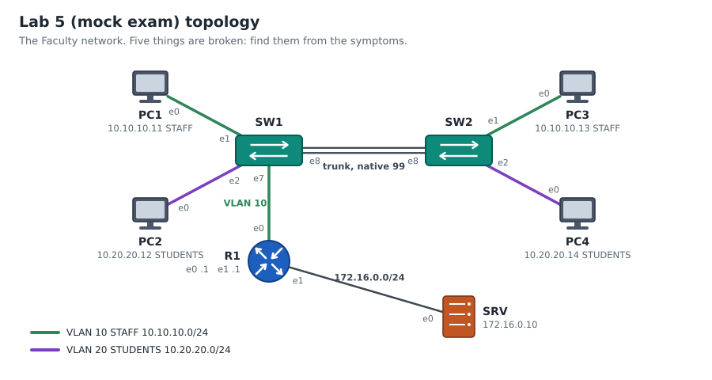

# Lab 5 · Mock exam 1 (covers Labs 1-4)

| | |
|---|---|
| **CCNA 200-301 v1.1 topics** | 1.1, 1.6, 1.7, 1.13, 2.1, 2.2 |
| **Time** | 2 hours: **Section A** theory (45 min) + **Section B** practical (75 min) |
| **Marks** | Section A: 20 (marked by your lecturer) · Section B: 10 (marked automatically by `labctl check 5`) |
| **Rules** | Closed book: no lab sheets, notes or other people. You *may* use `?` and the device help. |

```bash
labctl hello 5
labctl start-lab 5
```

Write **all** answers in `my-work/answers/lab05.md`. For multiple-choice questions, write only the letter (`Q1: B`).

---

## Section A · Theory (20 marks, 1 mark each)

**Q1.** Which device forwards traffic between different IP networks using a routing table?
A) Layer 2 switch  B) Router  C) Hub  D) Access point

**Q2.** How many usable host addresses does a /26 subnet provide?
A) 62  B) 64  C) 30  D) 126

**Q3.** What is the broadcast address of 192.168.50.64/27?
A) 192.168.50.95  B) 192.168.50.96  C) 192.168.50.127  D) 192.168.50.63

**Q4.** Which address is a private (RFC 1918) address?
A) 172.32.1.1  B) 192.169.1.1  C) 172.20.5.5  D) 11.0.0.1

**Q5.** Which subnet mask is the same as /28?
A) 255.255.255.240  B) 255.255.255.248  C) 255.255.255.224  D) 255.255.255.252

**Q6.** A LAN needs 25 hosts. Which prefix gives enough addresses while wasting the fewest?
A) /25  B) /26  C) /27  D) /28

**Q7.** A switch receives a frame whose destination MAC is not in its MAC address table. What does it do?
A) Drops the frame
B) Floods it out of every port in the same VLAN except the one it arrived on
C) Sends it to the default gateway
D) Sends an ARP request first

**Q8.** Which field does a switch use to *learn* MAC addresses?
A) Source MAC  B) Destination MAC  C) Source IP  D) Destination IP

**Q9.** An ARP request is sent to which destination MAC address?
A) The default gateway's MAC  B) ff:ff:ff:ff:ff:ff  C) 00:00:00:00:00:00  D) The switch's MAC

**Q10.** What is the default MAC address-table aging time on a Cisco switch?
A) 30 seconds  B) 60 seconds  C) 300 seconds  D) 3600 seconds

**Q11.** Which command shows the access ports that belong to each VLAN?
A) `show vlan brief`  B) `show ip route`  C) `show interfaces trunk`  D) `show running-config | include hostname`

**Q12.** How long is an 802.1Q tag, and how many bits is the VLAN ID?
A) 4 bytes, 12 bits  B) 2 bytes, 12 bits  C) 4 bytes, 10 bits  D) 6 bytes, 16 bits

**Q13.** How are native VLAN frames sent across an 802.1Q trunk?
A) Tagged with VLAN 1  B) Untagged  C) They are dropped  D) Double-tagged

**Q14.** *(short answer)* What mode is a device in when the prompt shows `R1(config-if)#`? Which single command returns you to `R1#`?

**Q15.** *(short answer)* Write the full Cisco command that copies the running configuration into the startup configuration.

**Q16.** *(short answer)* A PC is configured with 10.10.10.13/24 and default gateway 10.10.11.1. What is wrong, and what will the PC fail to do?

**Q17.** *(short answer)* Two PCs are in VLAN 30 on two different switches. Their access ports are correct, but they can't ping each other. Give **two** possible causes on the link between the switches.

**Q18.** *(short answer)* `show interfaces status` shows a port as `disabled`. What does that mean, and which interface command fixes it?

**Q19.** *(short answer)* What is the network address of the host 192.168.50.100/28?

**Q20.** *(short answer)* In one or two sentences, explain how VLANs affect broadcast domains.

---

## Section B · Practical: fix the Faculty network (10 marks)



**The design (this is correct, and you must not change it):**

| Device | Port / interface | Should be |
|---|---|---|
| SW1, SW2 | VLANs | 10 STAFF, 20 STUDENTS, 99 NATIVE |
| SW1 | e1 / e2 / e7 | access VLAN 10 / access VLAN 20 / access VLAN 10 (to R1) |
| SW2 | e1 / e2 | access VLAN 10 / access VLAN 20 |
| SW1 ↔ SW2 | e8 | trunk, native 99, allowed 10,20,99 |
| PC1, PC3 | e0 | 10.10.10.11/24 and 10.10.10.13/24, gateway 10.10.10.1 |
| PC2, PC4 | e0 | 10.20.20.12/24 and 10.20.20.14/24 (students have no gateway) |
| R1 | e0 / e1 | 10.10.10.1/24 / 172.16.0.1/24 |
| SRV | e0 | 172.16.0.10/24, gateway 172.16.0.1, web page on port 80 |

**The help-desk tickets:**

1. *"The two student PCs (PC2 and PC4) can't reach each other."*
2. *"Staff can't open the file server at http://172.16.0.10."*
3. *"PC3 in the staff room can't reach anything at all."*

There are **five faults** in total. Each is worth 2 marks. Find them with `show` commands, `ping` and `ip addr` / `ip route` before you change anything. That's how you'd work on a live network.

Useful checks: `net PC1 curl -s http://172.16.0.10` · `net SW1 show vlan brief` · `net SW2 show interfaces trunk` · `net R1 show interface brief` · `net PC3 ip addr` · `net SRV ip route`

In `my-work/answers/lab05.md`, under **Practical notes**, write one line per fault: *where it was, how you found it, the command that fixed it.*

```bash
labctl check 5      # as often as you like
labctl submit 5     # before the time is up
```
