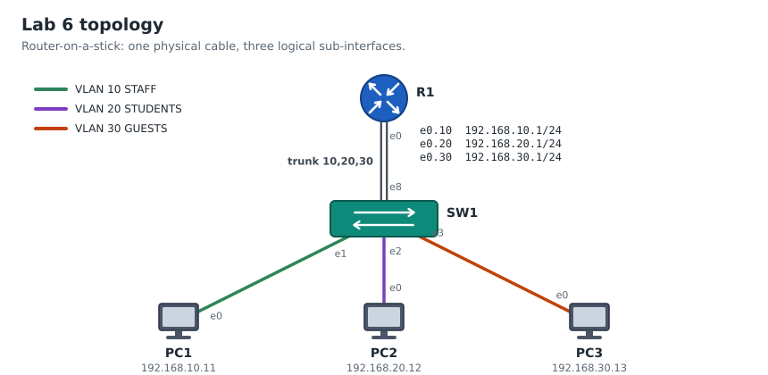
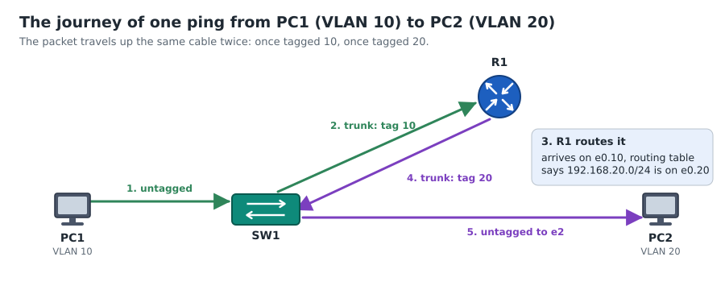

# Lab 6 · Inter-VLAN routing with router-on-a-stick

| | |
|---|---|
| **CCNA 200-301 v1.1 topics** | 2.2 Trunk ports (802.1Q) · 3.1 Components of the routing table · 1.6 IPv4 addressing (one subnet per VLAN) |
| **Time** | 2 hours |
| **You will be able to** | give each VLAN its own subnet, configure 802.1Q sub-interfaces on a router, trunk a switch to a router, and trace a packet between VLANs |

```bash
labctl hello 6
labctl start-lab 6
```



| VLAN | Name | Subnet | Gateway (R1 sub-interface) | Host |
|---|---|---|---|---|
| 10 | STAFF | 192.168.10.0/24 | e0.10 = 192.168.10.1 | PC1 192.168.10.11 |
| 20 | STUDENTS | 192.168.20.0/24 | e0.20 = 192.168.20.1 | PC2 192.168.20.12 |
| 30 | GUESTS | 192.168.30.0/24 | e0.30 = 192.168.30.1 | PC3 192.168.30.13 |

The VLANs and access ports on SW1 are already done. The PCs are already addressed. Your job is the **trunk to R1** and **R1's sub-interfaces**.

---

## The big idea

In Lab 4, VLANs kept groups apart. But staff still need to reach the students' printer, and everyone needs the Internet. Something at **Layer 3** has to join the VLANs together, under control. That something is a router.

> **Know-how card: router-on-a-stick**
> - **What it is:** one physical router port, configured as a trunk, split into **sub-interfaces**, one per VLAN. Each sub-interface is the default gateway for its VLAN.
> - **When you use it:** small sites with a router but no Layer 3 switch. Bigger sites use a Layer 3 switch with **SVIs** (`interface vlan 10`) instead, which works the same way but much faster.
> - **How (Cisco):**
>   ```text
>   interface g0/0.10
>    encapsulation dot1Q 10
>    ip address 192.168.10.1 255.255.255.0
>   ```
> - **Analogy:** one receptionist (the router) at a single desk (the port), with a separate in-tray for each department (sub-interfaces). Mail comes in with a coloured label (VLAN tag), gets re-addressed, and leaves with a different label.



---

## Part A · See the problem

```bash
net PC1 ping -c 2 192.168.10.1     # its own gateway: no reply yet
net PC1 ping -c 2 192.168.20.12    # PC2: no reply
net SW1 show vlan brief
net SW1 show interfaces trunk
```

**What you should see:** nothing works yet. e8 (towards R1) is still an access port in VLAN 1 and there are no trunks.

---

## Part B · Trunk SW1 to the router

```text
net SW1
SW1> enable
SW1# configure terminal
SW1(config)# interface e8
SW1(config-if)# description TRUNK-TO-R1
SW1(config-if)# switchport mode trunk
SW1(config-if)# switchport trunk allowed vlan 10,20,30
SW1(config-if)# end
SW1# show interfaces trunk
SW1# write memory
SW1# exit
```

---

## Part C · Sub-interfaces on R1

In this lab the sub-interfaces **e0.10**, **e0.20** and **e0.30** already exist, each already bound to its VLAN tag. On a Cisco router you would create them, and the `encapsulation dot1Q N` line is what binds each one to its tag. Here you only add the addresses:

```text
net R1
R1# show interface brief
R1# configure terminal
R1(config)# interface e0.10
R1(config-if)# description STAFF-GATEWAY
R1(config-if)# ip address 192.168.10.1/24
R1(config-if)# interface e0.20
R1(config-if)# ip address 192.168.20.1/24
R1(config-if)# interface e0.30
R1(config-if)# ip address 192.168.30.1/24
R1(config-if)# end
R1# show ip route
R1# write memory
```

**What you should see in `show ip route`:**

```text
C>* 192.168.10.0/24 is directly connected, e0.10
C>* 192.168.20.0/24 is directly connected, e0.20
C>* 192.168.30.0/24 is directly connected, e0.30
```

Three networks, all through **one** physical cable. Notice that e0 itself has **no** IP address: the parent interface only carries the tagged frames.

---

## Part D · Test and trace

```bash
net PC1 ping -c 3 192.168.20.12
net PC1 ping -c 3 192.168.30.13
net PC2 ping -c 3 192.168.30.13
net PC1 traceroute -n 192.168.20.12
```

**What you should see:** every ping works. The traceroute shows `1 192.168.10.1` (R1's STAFF gateway), then `2 192.168.20.12`.

Now watch the same packet cross the trunk twice. In T2: `net capture R1 e0 lab06-stick`. In T1: `net PC1 ping -c 1 192.168.20.12`. Stop the capture.

**What you should see:** four lines for one ping. The echo request arrives tagged `vlan 10` and leaves tagged `vlan 20`. The reply arrives tagged `vlan 20` and leaves tagged `vlan 10`.

---

## Part E · Think about the limits

Run a long ping from PC1 to PC2 (`net PC1 ping -c 200 -i 0.01 -q 192.168.20.12`) and think: every packet between VLANs crosses the same cable **twice**. If 300 students stream video to a server in the STAFF VLAN, that single link is the bottleneck. This is why campus networks route between VLANs on **Layer 3 switches** (SVIs) instead.

---

## Cisco IOS vs this lab

| Task | Cisco IOS | This lab |
|---|---|---|
| Create sub-interface | `interface g0/0.10` | already created as `e0.10` |
| Bind to VLAN | `encapsulation dot1Q 10` | done for you when the lab starts |
| Native VLAN on router | `encapsulation dot1Q 99 native` | not used in this lab |
| Parent interface | `interface g0/0` → `no shutdown` (sub-interfaces follow it) | e0 is already up |
| Layer 3 switch alternative | `ip routing` + `interface vlan 10` (SVI) | theory only |

---

## Questions

Write your answers in `my-work/answers/lab06.md`.

**Q1.** Why can't PC1 (VLAN 10) talk to PC2 (VLAN 20) without a router, even though they're plugged into the same switch?

**Q2.** What does `encapsulation dot1Q 20` do on a Cisco sub-interface? What would happen if you typed `encapsulation dot1Q 30` on `g0/0.20` by mistake?

**Q3.** Why must SW1's port e8 be a trunk and not an access port?

**Q4.** Write the complete Cisco configuration for R1's GUESTS sub-interface, using the mask form of the address.

**Q5.** In your capture, one ping produced four frames on R1 e0. Explain each one (direction and VLAN tag).

**Q6.** Give one advantage and one disadvantage of router-on-a-stick compared with a Layer 3 switch using SVIs.

**Q7.** GUESTS should reach the Internet but never the STAFF VLAN. Router-on-a-stick alone can't do this. What feature would you add, and where? (Hint: a later lab.)

---

## Key terms

| Term | Meaning |
|---|---|
| Inter-VLAN routing | Routing traffic between VLANs (each VLAN = its own subnet) |
| Sub-interface | A logical interface on a physical port, e.g. `g0/0.10` |
| Router-on-a-stick | One trunked router port with a sub-interface per VLAN |
| SVI | Switch Virtual Interface (`interface vlan 10`) on a Layer 3 switch |
| Default gateway per VLAN | Each VLAN's hosts use the router address in their own subnet |

## Finish

```bash
labctl check 6
labctl submit 6
```
