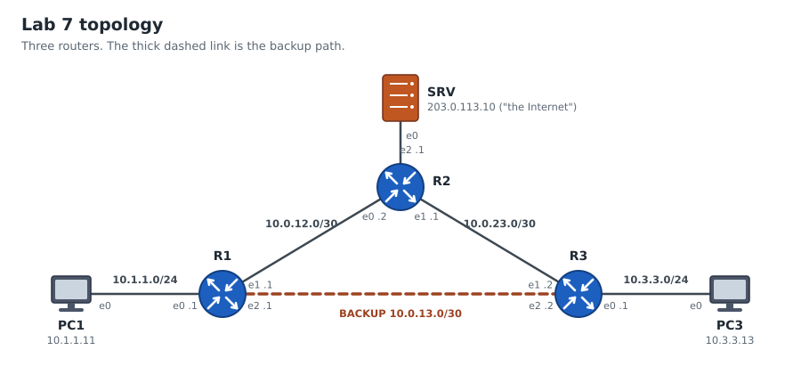
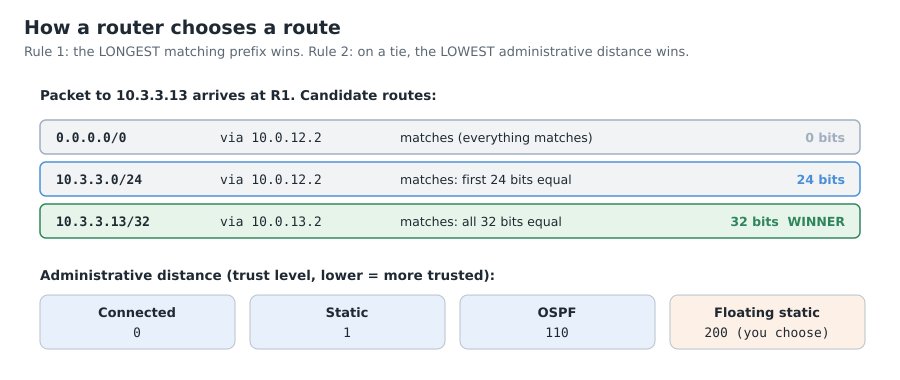

# Lab 7 · Static routing, default routes and floating statics

| | |
|---|---|
| **CCNA 200-301 v1.1 topics** | 3.1 Components of the routing table (prefix, mask, next hop, administrative distance, gateway of last resort) · 3.2 How a router makes a forwarding decision (longest match, AD) · 3.3 IPv4 static routing: default, network, host and floating static |
| **Time** | 2 hours |
| **You will be able to** | write network, default, host and floating static routes, predict which route wins, and build a backup path that takes over automatically |

```bash
labctl hello 7
labctl start-lab 7
```



| Router | e0 | e1 | e2 |
|---|---|---|---|
| R1 | 10.1.1.1/24 (LAN-1, PC1 .11) | 10.0.12.1/30 → R2 | 10.0.13.1/30 → R3 (backup) |
| R2 | 10.0.12.2/30 → R1 | 10.0.23.1/30 → R3 | 203.0.113.1/24 (Internet, SRV .10) |
| R3 | 10.3.3.1/24 (LAN-3, PC3 .13) | 10.0.23.2/30 → R2 | 10.0.13.2/30 → R1 (backup) |

All interfaces are addressed and up. **No routes have been configured.**

---

## Part A · What does each router know?

```bash
net R1 show ip route
net PC1 ping -c 2 10.3.3.13
```

**What you should see:** R1 only has its three connected networks. The ping fails: R1 has no idea where 10.3.3.0/24 is.

> **Know-how card: static route**
> - **What it is:** a route you type in by hand: *"to reach network X, hand the packet to next hop Y"*.
> - **When you use it:** small networks, stub sites with a single way out, default routes to an ISP, and backup paths. It's predictable and uses no CPU or bandwidth, but it never adapts by itself.
> - **How (FRRouting):** `ip route 10.3.3.0/24 10.0.12.2`
>   **How (Cisco):** `ip route 10.3.3.0 255.255.255.0 10.0.12.2`
> - **Analogy:** a road sign you put up yourself. It points the same way until you take it down, even if the bridge it points to has collapsed (unless the road leading to the bridge closes too: see Part D).

> ⚠️ **Routing works in both directions.** A ping needs a route *there* and a route *back*. Most "my static route doesn't work" problems are a missing return route.

---

## Part B · Network routes via R2

```text
net R1
R1# configure terminal
R1(config)# ip route 10.3.3.0/24 10.0.12.2
R1(config)# end
R1# exit
```

Try `net PC1 ping -c 2 10.3.3.13`. It **still fails**. Use `net R2 show ip route` to work out why.

Now add the routes R2 and R3 need:

| Router | Destination | Next hop |
|---|---|---|
| R2 | 10.1.1.0/24 | 10.0.12.1 |
| R2 | 10.3.3.0/24 | 10.0.23.2 |
| R3 | 10.1.1.0/24 | 10.0.23.1 |

```bash
net PC1 ping -c 3 10.3.3.13
net PC1 traceroute -n 10.3.3.13
```

**What you should see:** replies, and the path `10.1.1.1 → 10.0.12.2 → 10.0.23.2 → 10.3.3.13`.

---

## Part C · Default routes (gateway of last resort)

> **Know-how card: default route**
> - **What it is:** `0.0.0.0/0`, a route that matches *every* destination. It's used only when nothing more specific matches.
> - **When you use it:** towards the Internet or the head office, whenever a site has one obvious way out.
> - **How:** `ip route 0.0.0.0/0 10.0.12.2` (Cisco: `ip route 0.0.0.0 0.0.0.0 10.0.12.2`).
> - **Analogy:** *"for anywhere not on this list, follow signs for the motorway."*

Give **R1** a default route to R2 (10.0.12.2), and **R3** a default route to R2 (10.0.23.1). R2 doesn't need one: SRV is directly connected to it.

```bash
net R1 show ip route         # look for: S>* 0.0.0.0/0 [1/0] via 10.0.12.2
net PC1 curl -s http://203.0.113.10
net PC3 ping -c 2 203.0.113.10
```

> **Reading `[1/0]`:** the first number is the **administrative distance** (how much the router trusts the source of the route). The second is the **metric** (the cost within that source).

---

## Part D · A floating static route (automatic backup)

> **Know-how card: floating static route**
> - **What it is:** a second static route to the *same* destination, with a **higher administrative distance**, so it "floats" unused until the main route disappears.
> - **When you use it:** a backup link (a 4G router, a second ISP, a slower private line).
> - **How:** add the AD at the end: `ip route 10.3.3.0/24 10.0.13.2 200`.
> - **Analogy:** a spare tyre in the boot. It's always there, but you only use it when the main tyre goes flat.



On **R1**: `ip route 10.3.3.0/24 10.0.13.2 200`
On **R3**: `ip route 10.1.1.0/24 10.0.13.1 200`

```bash
net R1 show ip route static
```

**What you should see:** two routes to 10.3.3.0/24. `S>* 10.3.3.0/24 [1/0] via 10.0.12.2` is selected (`>*`). `S   10.3.3.0/24 [200/0] via 10.0.13.2` sits in the table unselected.

**Now kill R2.** Shut down both of its router-facing interfaces:

```text
net R2
R2# configure terminal
R2(config)# interface e0
R2(config-if)# shutdown
R2(config-if)# interface e1
R2(config-if)# shutdown
R2(config-if)# end
R2# exit
```

```bash
net R1 show ip route static
net PC1 traceroute -n 10.3.3.13
```

**What you should see:** the `[200/0] via 10.0.13.2` route is now selected, and the traceroute goes `10.1.1.1 → 10.0.13.2 → 10.3.3.13`, straight over the backup link.

Why did it switch? R1's interface e1 lost its link, so 10.0.12.2 became unreachable and the main route was withdrawn. The spare tyre went on.

**Bring R2 back** (`no shutdown` on both interfaces) and check that traffic returns to the main path.

> **Watch out:** a floating static only takes over when the router *notices* the main path is gone, usually because its own interface went down. If R2 failed somewhere further away while R1's link stayed up, R1 would keep sending traffic into a black hole. Dynamic routing (Lab 8) solves this.

---

## Part E · A host route and longest-prefix match

On **R1**, add a /32 route that sends traffic for **PC3 only** over the backup link:

```text
R1(config)# ip route 10.3.3.13/32 10.0.13.2
```

```bash
net R1 show ip route 10.3.3.13      # "Routing entry for 10.3.3.13/32" via 10.0.13.2
net R1 show ip route 10.3.3.50      # "Routing entry for 10.3.3.0/24" via 10.0.12.2
net PC1 traceroute -n 10.3.3.13     # goes over the backup link
```

R1 now has three routes that match 10.3.3.13: `0.0.0.0/0`, `10.3.3.0/24` and `10.3.3.13/32`. The **longest prefix (/32) always wins**, whatever its administrative distance. AD only breaks ties between routes of the *same* length.

---

## Cisco IOS vs this lab

| Task | Cisco IOS | This lab (FRRouting) |
|---|---|---|
| Network route | `ip route 10.3.3.0 255.255.255.0 10.0.12.2` | `ip route 10.3.3.0/24 10.0.12.2` (the mask form also works) |
| Default route | `ip route 0.0.0.0 0.0.0.0 10.0.12.2` | `ip route 0.0.0.0/0 10.0.12.2` |
| Floating static | `... 10.0.13.2 200` | same |
| Only static routes | `show ip route static` | same |
| Gateway of last resort | shown at the top of `show ip route` | shown as the `0.0.0.0/0` entry |

---

## Questions

Write your answers in `my-work/answers/lab07.md`.

**Q1.** After Part B's first step, R1 had a route to 10.3.3.0/24 but the ping still failed. Explain exactly where the replies (or the requests) were dropped, and why.

**Q2.** In `S>* 0.0.0.0/0 [1/0] via 10.0.12.2`, explain each part: `S`, `>`, `*`, `0.0.0.0/0`, `1`, `0` and `via 10.0.12.2`.

**Q3.** List the default administrative distances of connected, static, OSPF and EIGRP routes. Why did we choose 200 for the floating statics?

**Q4.** Why did the backup only work once **both** R1 and R3 had floating routes?

**Q5.** A packet for 10.3.3.13 arrives at R1 after Part E. Which route is used, and why? Which route does a packet for 10.3.3.50 use?

**Q6.** Give one advantage and one disadvantage of static routing compared with a dynamic routing protocol.

**Q7.** Write the Cisco command for a floating default route to a backup ISP at 192.0.2.1 with AD 250.

---

## Key terms

| Term | Meaning |
|---|---|
| Static route | A manually configured route (AD 1) |
| Default route | `0.0.0.0/0`: matches everything; the gateway of last resort |
| Host route | A /32 route to one single address |
| Floating static | A static route with a raised AD, used as a backup |
| Administrative distance | Trust level of a route source; lower wins |
| Longest-prefix match | The most specific matching route is always chosen first |

## Finish

```bash
labctl check 7
labctl submit 7
```

> The marker **switches R2 off for a few seconds** to test your backup path, then switches it back on.
