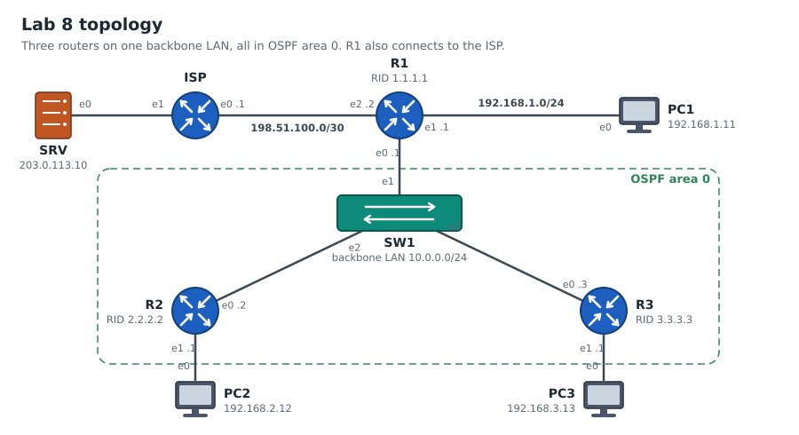
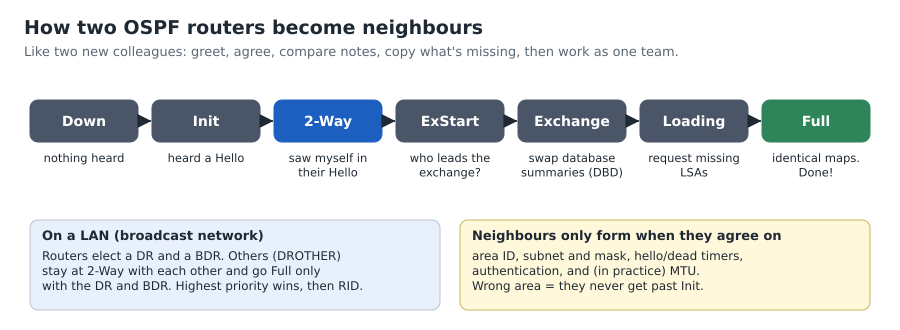

# Lab 8 · OSPFv2 in a single area

| | |
|---|---|
| **CCNA 200-301 v1.1 topics** | 3.4 Configure and verify single-area OSPFv2: neighbour adjacencies, point-to-point and broadcast (DR/BDR selection), router ID · 3.1 / 3.2 routing table and AD (OSPF = 110) |
| **Time** | 2.5 hours |
| **You will be able to** | enable OSPF, set router IDs, advertise networks, use passive interfaces, control the DR election, share a default route, and read neighbour and route tables |

```bash
labctl hello 8
labctl start-lab 8
```



| Router | Router ID | e0 (backbone LAN) | e1 (PC LAN) | other |
|---|---|---|---|---|
| R1 | 1.1.1.1 | 10.0.0.1/24 | 192.168.1.1/24 (PC1 .11) | e2 198.51.100.2/30 → ISP, static default route already set |
| R2 | 2.2.2.2 | 10.0.0.2/24 | 192.168.2.1/24 (PC2 .12) | - |
| R3 | 3.3.3.3 | 10.0.0.3/24 | 192.168.3.1/24 (PC3 .13) | - |
| ISP | - | 198.51.100.1/30 | 203.0.113.1/24 (SRV .10) | not part of OSPF: don't touch |

---

## The big idea

In Lab 7 you typed every road sign by hand. With three routers that took 7 static routes. With 50 routers it would take thousands, and they couldn't react to a link failing in another building.

> **Know-how card: OSPF (Open Shortest Path First)**
> - **What it is:** a **link-state** routing protocol. Every router tells its neighbours about its own links (in LSAs). Everyone ends up with an identical **map** of the area, and each router runs Dijkstra's shortest-path algorithm on that map to build its routing table.
> - **When you use it:** enterprise and campus networks of any size. It's an open standard, so it runs on Cisco, Juniper, MikroTik, Linux and more.
> - **Key numbers:** administrative distance **110**. Cost = reference bandwidth ÷ interface bandwidth. Hellos every **10 s** and dead after **40 s** on Ethernet.
> - **Analogy:** instead of every driver being told directions (static), every town publishes its own local roads, and every driver carries the same full map and works out the best route themselves. Close a road and the news spreads in seconds, so everyone re-plans.



---

## Part A · Enable OSPF on R1

```text
net R1
R1# configure terminal
R1(config)# router ospf
R1(config-router)# ospf router-id 1.1.1.1
R1(config-router)# network 10.0.0.0/24 area 0
R1(config-router)# network 192.168.1.0/24 area 0
R1(config-router)# exit
R1(config)# interface e1
R1(config-if)# ip ospf passive
R1(config-if)# interface e0
R1(config-if)# ip ospf priority 100
R1(config-if)# end
R1# write memory
```

What each line does:

| Line | Meaning |
|---|---|
| `ospf router-id 1.1.1.1` | The router's name inside OSPF. Set it by hand so it never changes by surprise. |
| `network 10.0.0.0/24 area 0` | *"Run OSPF on any interface inside this range and advertise its subnet, in area 0 (the backbone)."* |
| `ip ospf passive` | *"Advertise this LAN, but never send Hellos out of it."* No routers live on the PC LAN, and Hellos there would only help an attacker. |
| `ip ospf priority 100` | Makes R1 the favourite in the DR election on the backbone LAN. |

> **Cisco IOS form:** `router ospf 1`, `router-id 1.1.1.1`, `network 10.0.0.0 0.0.0.255 area 0` (note the **wildcard mask**: the inverse of the subnet mask), `passive-interface g0/1`.

---

## Part B · R2 and R3

Configure **R2** (router ID 2.2.2.2, **priority 50** on e0) and **R3** (router ID 3.3.3.3, **priority 0** on e0) the same way: both their networks in area 0, with e1 passive.

> Priority **0** means *"never become DR or BDR"*. You'd use it for a small branch router that shouldn't carry the extra work.

Wait about **40 seconds** (the wait timer), then on any router:

```text
R1# show ip ospf neighbor
```

**What you should see on R1:**

```text
Neighbor ID     Pri State           Up Time  Dead Time Address         Interface ...
2.2.2.2          50 Full/Backup     ...      ...       10.0.0.2        e0:10.0.0.1
3.3.3.3           0 Full/DROther    ...      ...       10.0.0.3        e0:10.0.0.1
```

---

## Part C · Control the DR election

> **Know-how card: DR and BDR**
> - **What it is:** on a shared LAN (a *broadcast* network), routers elect a **Designated Router** and a **Backup DR**. Everyone goes Full with the DR and BDR only, and exchanges updates through them, instead of everyone with everyone.
> - **How the winner is chosen:** highest **priority**, then highest **router ID**. The election is **not pre-emptive**: a better router that arrives later does *not* take over.
> - **Analogy:** a class representative. Everyone reports to the rep, and the rep tells everyone else. Changing your mind after the vote doesn't unseat the rep. You have to hold a new election.

Look at who won:

```text
R2# show ip ospf interface e0
```

Find the line `Designated Router (ID) ...`. If it isn't **1.1.1.1** (whoever started OSPF first may have won), hold a new election. On **all three** routers, within a few seconds of each other:

```text
R1# clear ip ospf process
```

Wait 40 seconds and check again. R1 should be **DR**, R2 **BDR** and R3 **DROTHER**.

---

## Part D · Read the routing tables

```text
R3# show ip route ospf
R3# show ip route
```

**What you should see on R3:**

```text
O>* 192.168.1.0/24 [110/N] via 10.0.0.1, e0, ...
O>* 192.168.2.0/24 [110/N] via 10.0.0.2, e0, ...
```

`[110/N]` = administrative distance 110, total cost N: the cost to cross the backbone LAN plus the cost of the remote PC LAN. Each link's cost is the reference bandwidth (100 Mbit/s by default) divided by the speed the interface reports, with a minimum of 1. Check yours with `show ip ospf interface e0` (look for `Cost:`). Nobody typed these routes: OSPF worked them out.

```bash
net PC1 ping -c 2 192.168.2.12
net PC1 ping -c 2 192.168.3.13
```

---

## Part E · Share the default route

PC3 can't reach the Internet server yet. Only R1 has the static default route to the ISP. Rather than typing defaults on every router, let R1 **advertise** its own:

```text
R1(config)# router ospf
R1(config-router)# default-information originate
```

```bash
net R3 show ip route ospf          # O>* 0.0.0.0/0 [110/...] via 10.0.0.1
net PC3 curl -s http://203.0.113.10
```

> `O>*` for 0.0.0.0/0 is an **external** route (the default came from outside OSPF). FRRouting labels it `E2` in `show ip ospf route`. Cisco shows it as `O*E2`.

---

## Part F · Watch OSPF heal (optional, no marks)

In T2, run `net PC2 ping 192.168.1.11` and leave it running. In T1, on R1: `interface e0` → `shutdown`. Watch the pings stop. Run `show ip ospf neighbor` on R2. After `no shutdown`, how long before the pings come back? Relate it to the Hello and Dead timers.

---

## Cisco IOS vs this lab

| Task | Cisco IOS | This lab (FRRouting) |
|---|---|---|
| Start OSPF | `router ospf 1` (process ID, locally significant) | `router ospf` |
| Router ID | `router-id 1.1.1.1` | `ospf router-id 1.1.1.1` |
| Network statement | `network 10.0.0.0 0.0.0.255 area 0` (wildcard) | `network 10.0.0.0/24 area 0` (prefix) |
| Interface method | `ip ospf 1 area 0` (under the interface) | `ip ospf area 0` (under the interface) |
| Passive | `passive-interface g0/1` (under router ospf) | `ip ospf passive` (under the interface) |
| Reset | `clear ip ospf process` (asks to confirm) | `clear ip ospf process` |
| External default | `O*E2 0.0.0.0/0` | `O>* 0.0.0.0/0` |

---

## Questions

Write your answers in `my-work/answers/lab08.md`.

**Q1.** Why is it good practice to set the router ID by hand? Without it, how does a router choose its router ID?

**Q2.** Convert `network 192.168.1.0/24 area 0` to Cisco wildcard form. What wildcard mask goes with a /30?

**Q3.** Why did we make e1 passive on every router? Give one security reason and one efficiency reason.

**Q4.** Explain why R2 and R3 are Full with R1, and why R2 is also Full with R3 on this LAN, but on a bigger LAN two DROTHER routers stay at 2-Way.

**Q5.** Copy one OSPF route from R3's table. In its `[110/N]`, what does 110 mean, and how was N calculated? (Use `show ip ospf interface` to find each link's cost.) Why do Fast Ethernet and Gigabit Ethernet links get the *same* cost with the default reference bandwidth?

**Q6.** You set R3's priority to 200 after the election. Does R3 become DR? What must happen first?

**Q7.** R2 and R3 can't form an adjacency. `show ip ospf neighbor` on R2 is empty. List four settings you'd compare on both routers.

**Q8.** Compare Lab 7 (static) and Lab 8 (OSPF): how many lines of routing configuration did each need, and what happens in each when a link fails?

---

## Key terms

| Term | Meaning |
|---|---|
| Link-state | Each router floods its own links; all build the same map (LSDB) |
| LSA / LSDB | Link-State Advertisement / Link-State Database (the map) |
| Router ID | 32-bit dotted name of an OSPF router |
| Area 0 | The backbone area; every other area must connect to it |
| Hello / Dead timer | 10 s / 40 s on Ethernet: keep-alive and failure detection |
| DR / BDR / DROTHER | Elected roles on a broadcast segment |
| Passive interface | Advertised in OSPF, but sends no Hellos |
| Cost | OSPF metric: reference bandwidth ÷ interface bandwidth |

## Finish

```bash
labctl check 8
labctl submit 8
```
