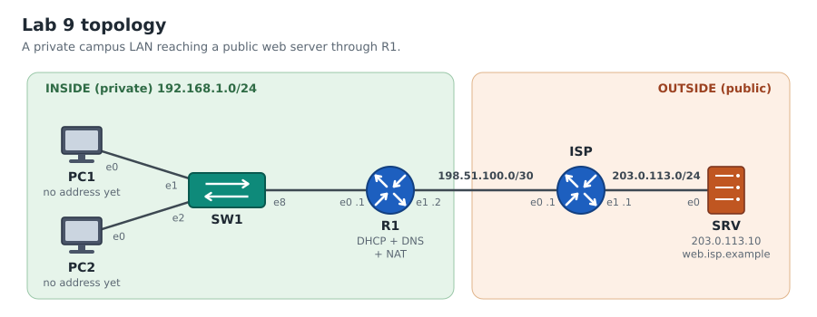
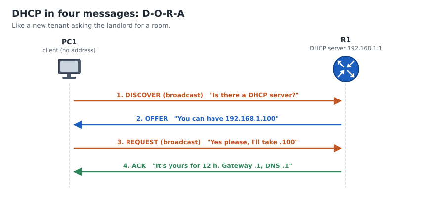
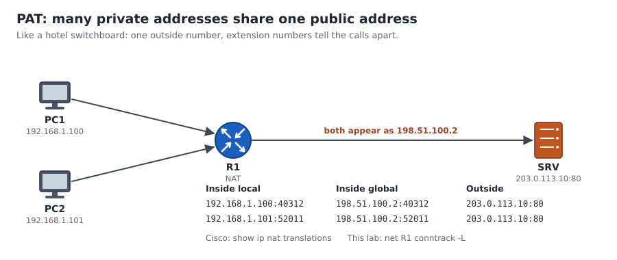

# Lab 9 · IP services: DHCP, DNS and NAT/PAT

| | |
|---|---|
| **CCNA 200-301 v1.1 topics** | 4.1 Configure and verify inside source NAT (static, pools, PAT) · 4.3 Explain the role of DHCP and DNS in the network · 4.6 Configure and verify DHCP client and relay (client side) |
| **Time** | 2.5 hours |
| **You will be able to** | run a DHCP server, read the DORA exchange, give clients a DNS server and resolve names, and use PAT to take a private network onto the Internet |

```bash
labctl hello 9
labctl start-lab 9
```



| Device | Interface | Address |
|---|---|---|
| PC1, PC2 | e0 | **none yet**: they'll ask by DHCP |
| R1 | e0 (inside) | 192.168.1.1/24 |
| R1 | e1 (outside) | 198.51.100.2/30 |
| ISP | e0 / e1 | 198.51.100.1/30 / 203.0.113.1/24 |
| SRV | e0 | 203.0.113.10/24, web server, name `web.isp.example` |

The ISP **has no route to 192.168.1.0/24**, and never will. Private addresses aren't routed on the Internet. That's the problem NAT solves in Part D.

---

## Part A · DHCP

> **Know-how card: DHCP**
> - **What it is:** *Dynamic Host Configuration Protocol*. A server hands out IP settings (address, mask, gateway, DNS server, lease time) to hosts that ask.
> - **When you use it:** for almost every PC, phone and printer. Servers and routers usually keep static addresses so they never move.
> - **How it works:** **D**iscover (broadcast) → **O**ffer → **R**equest (broadcast) → **A**ck. If the server is on another subnet, the router forwards the broadcasts with a **DHCP relay** (`ip helper-address`).
> - **Analogy:** checking into a hostel. *"Any rooms?" / "Room 100 is free." / "I'll take room 100." / "It's yours until Friday; breakfast is downstairs, reception is at the front."* The lease ends Friday unless you renew.



**1.** Open **`my-work/lab09/dnsmasq.conf`** from the Explorer. This is R1's DHCP and DNS server configuration. Fill in the four `___` blanks using the table above and the comments in the file, then save with `Ctrl+S`.

**2.** In T2, capture the DHCP conversation: `net capture PC1 e0 lab09-dhcp`

**3.** In T1, start the server, then ask for addresses:

```bash
net R1 dhcp-server my-work/lab09/dnsmasq.conf
net PC1 dhcp
net PC2 dhcp
```

Stop the capture in T2.

**What you should see:**
- `DHCP lease: 192.168.1.1xx/24  gateway 192.168.1.1  dns 192.168.1.1` for each PC.
- In the capture: `BOOTP/DHCP, Request` from `0.0.0.0.68 > 255.255.255.255.67` (the client has no address yet, so it broadcasts), then the server's replies. Run `tcpdump -nr my-work/captures/lab09-dhcp.pcap -v | grep "DHCP-Message"` to see the four message types.

If `dhcp-server` reports an error, there's a typo in your file. Read the message, fix the file and run it again.

```bash
sudo cat /run/netlab/R1.leases          # the server's lease book: expiry, MAC, IP, hostname
net PC1 ip addr show e0 ; net PC1 ip route ; net PC1 cat /etc/resolv.conf
```

---

## Part B · DNS

> **Know-how card: DNS**
> - **What it is:** the *Domain Name System*. It turns names (`web.isp.example`) into IP addresses (203.0.113.10). It uses UDP port 53 (and TCP 53 for big answers).
> - **When you use it:** every time anyone types a name instead of an address, which is nearly always.
> - **How the client knows the server:** DHCP option 6 (Part A) or static configuration.
> - **Analogy:** a phone's contacts list. You tap "Mum" and the phone dials the number. Nobody memorises numbers any more.

```bash
net PC1 nslookup web.isp.example
net PC1 dig web.isp.example          # more detail: question, answer, server, time
```

**What you should see:** `Address: 203.0.113.10`, answered by `192.168.1.1`.

Try `net PC1 ping -c 2 web.isp.example`. The name now resolves, but the ping still fails. Find out why in Part C.

---

## Part C · Routing out, and why it still fails

R1 has no route to the Internet. Give it a default route to the ISP:

```text
net R1
R1# configure terminal
R1(config)# ip route 0.0.0.0/0 198.51.100.1
R1(config)# end
R1# write memory
R1# exit
```

```bash
net PC1 ping -c 2 203.0.113.10       # still fails!
```

Find out where the packets die. In T2: `net capture ISP e1 lab09-nonat -- icmp`. In T1, ping again, then stop T2.

**What you should see:** echo requests **from 192.168.1.10x** reach SRV, but SRV's replies go to its gateway (the ISP router), and the ISP has no route to 192.168.1.0/24. Run `net ISP show ip route` to confirm. The replies are dropped.

> **Analogy:** you post a letter with "Room 12" as the return address but no hotel name. It arrives, but the reply can never find its way back.

---

## Part D · NAT with overload (PAT)

> **Know-how card: NAT / PAT**
> - **What it is:** *Network Address Translation*. The edge router rewrites the private **source** address of outgoing packets to its own public address, remembers the change, and reverses it for the replies. **PAT** (NAT *overload*) also rewrites the source **port**, so thousands of inside hosts can share **one** public IP.
> - **Cisco terms:** *inside local* (192.168.1.100, the private address) → *inside global* (198.51.100.2, the public address it's shown as) → *outside global* (203.0.113.10, the server).
> - **When you use it:** at almost every home and company Internet edge. It's the main reason IPv4 hasn't run out completely.
> - **Analogy:** a hotel switchboard. Every room calls out using the hotel's single phone number, and the operator notes which extension made each call, so returning calls are put through to the right room.



On Cisco IOS, PAT is:

```text
interface g0/0
 ip nat inside
interface g0/1
 ip nat outside
access-list 1 permit 192.168.1.0 0.0.0.255
ip nat inside source list 1 interface g0/1 overload
```

In this lab, R1 is a Linux router, so the same job is **one rule** in its firewall's NAT table (*"anything leaving through e1: rewrite its source to e1's address"*):

```bash
net R1 iptables -t nat -A POSTROUTING -o e1 -j MASQUERADE
net R1 iptables -t nat -L POSTROUTING -n -v
```

Now test:

```bash
net PC1 ping -c 2 web.isp.example
net PC1 curl -s http://web.isp.example
net PC2 curl -s http://web.isp.example
```

**What you should see:** *"You reached the Internet through NAT. Well done!"*

---

## Part E · See the translations

```bash
net PC1 curl -s http://web.isp.example >/dev/null ; net PC2 curl -s http://web.isp.example >/dev/null
net R1 conntrack -L -p tcp
```

**What you should see:** one line per connection, like:

```text
tcp ... src=192.168.1.100 dst=203.0.113.10 sport=40312 dport=80 ... src=203.0.113.10 dst=198.51.100.2 sport=80 dport=40312 ...
```

Read it as Cisco's `show ip nat translations`: the first half is the packet as PC1 sent it (inside local), and the second half is the reply as it really travelled (to the inside global address 198.51.100.2).

Finally, capture on the ISP side (`net capture ISP e0 lab09-nat -- tcp port 80`) while PC1 and PC2 both use `curl`. Every packet the ISP sees comes from **198.51.100.2**. The private addresses never leave your network.

> ⚠️ The NAT rule and the DHCP server aren't part of `write memory`. `labctl save` keeps the NAT rule. If your codespace restarts, run `net R1 dhcp-server my-work/lab09/dnsmasq.conf` again.

---

## Cisco IOS vs this lab

| Task | Cisco IOS | This lab |
|---|---|---|
| DHCP pool | `ip dhcp pool LAN` · `network 192.168.1.0 255.255.255.0` · `default-router 192.168.1.1` · `dns-server 192.168.1.1` | `dnsmasq.conf`: `dhcp-range`, `option:router`, `option:dns-server` |
| Exclude addresses | `ip dhcp excluded-address 192.168.1.1 192.168.1.99` | the pool simply starts at .100 |
| Leases | `show ip dhcp binding` | `cat /run/netlab/R1.leases` |
| DHCP relay | `ip helper-address 10.9.9.9` on the client-side interface | not needed (server on the same LAN) |
| Client | `ip address dhcp` (router) / *obtain automatically* (PC) | `net PC1 dhcp` |
| PAT | `ip nat inside source list 1 interface g0/1 overload` | `iptables -t nat -A POSTROUTING -o e1 -j MASQUERADE` |
| Translations | `show ip nat translations` | `conntrack -L` |
| Static NAT | `ip nat inside source static 192.168.1.5 198.51.100.5` | `iptables -t nat ... -j DNAT/SNAT` (not in this lab) |

---

## Questions

Write your answers in `my-work/answers/lab09.md`.

**Q1.** Name the four DHCP messages in order. Which are broadcasts, and why must the first one be a broadcast?

**Q2.** Besides an IP address and mask, name three settings a DHCP server gave your PCs.

**Q3.** If the DHCP server were on another subnet, the client's broadcast would never reach it. What does a Cisco router need (command and interface) to fix that?

**Q4.** In Part C, the ping reached SRV but failed anyway. Explain exactly why.

**Q5.** Using the PAT picture and your `conntrack` output, define *inside local*, *inside global* and *outside global*, giving the actual addresses from this lab.

**Q6.** How can PC1 and PC2 share one public address at the same time without the replies getting mixed up?

**Q7.** Static NAT, dynamic NAT (pool) and PAT: give one situation where each would be used.

**Q8.** Which transport protocol and port does DNS normally use? What happens to your PCs if the DNS server dies but routing and NAT still work?

---

## Key terms

| Term | Meaning |
|---|---|
| DHCP / DORA | Automatic IP configuration: Discover, Offer, Request, Ack |
| Lease | How long a client may keep its address before renewing |
| DHCP relay | A router forwarding DHCP broadcasts to a server on another subnet |
| DNS | Name → address resolution (UDP/TCP 53) |
| NAT | Rewriting IP addresses as packets cross the edge |
| PAT / overload | Many inside hosts sharing one public address, told apart by port |
| Inside local / inside global | The private address / the public address it is translated to |

## Finish

```bash
labctl check 9
labctl submit 9
```
