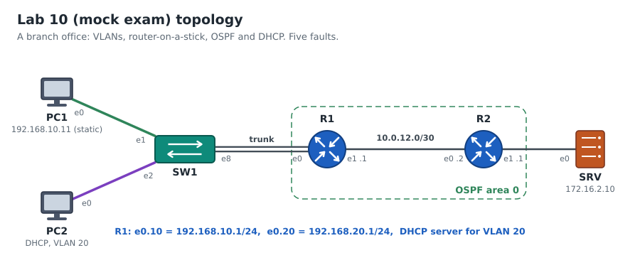

# Lab 10 · Mock exam 2 (covers Labs 6-9)

| | |
|---|---|
| **CCNA 200-301 v1.1 topics** | 2.2, 3.1, 3.2, 3.3, 3.4, 4.1, 4.3, 4.6 |
| **Time** | 2 hours: **Section A** theory (45 min) + **Section B** practical (75 min) |
| **Marks** | Section A: 20 (marked by your lecturer) · Section B: 10 (marked automatically by `labctl check 10`) |
| **Rules** | Closed book: no lab sheets, notes or other people. You *may* use `?` and the device help. |

```bash
labctl hello 10
labctl start-lab 10
```

Write **all** answers in `my-work/answers/lab10.md`. For multiple-choice questions, write only the letter (`Q1: B`).

---

## Section A · Theory (20 marks, 1 mark each)

**Q1.** On a Cisco router-on-a-stick, which sub-interface command binds `g0/0.20` to VLAN 20?
A) `switchport access vlan 20`  B) `encapsulation dot1Q 20`  C) `vlan 20`  D) `ip vlan 20`

**Q2.** On a Layer 3 switch, which interface acts as the default gateway for a VLAN?
A) SVI (`interface vlan 10`)  B) Sub-interface  C) Loopback  D) Tunnel

**Q3.** What is the default administrative distance of a static route?
A) 0  B) 1  C) 110  D) 120

**Q4.** What is the default administrative distance of OSPF?
A) 90  B) 100  C) 110  D) 120

**Q5.** A router has these routes: `10.0.0.0/8 via A`, `10.1.0.0/16 via B`, `10.1.1.0/24 via C`, `0.0.0.0/0 via D`. Which next hop is used for a packet to **10.1.1.200**?
A) A  B) B  C) C  D) D

**Q6.** Using the same table, which next hop is used for a packet to **10.1.2.5**?
A) A  B) B  C) C  D) D

**Q7.** OSPF already provides a route to 10.5.5.0/24. Which static route will act **only as a backup** to it?
A) `ip route 10.5.5.0 255.255.255.0 192.0.2.2`
B) `ip route 10.5.5.0 255.255.255.0 192.0.2.2 1`
C) `ip route 10.5.5.0 255.255.255.0 192.0.2.2 120`
D) `ip route 10.5.5.0 255.255.255.0 192.0.2.2 100`

**Q8.** What are the default OSPF Hello and Dead intervals on Ethernet?
A) 5 s / 20 s  B) 10 s / 40 s  C) 30 s / 120 s  D) 10 s / 30 s

**Q9.** How is the OSPF Designated Router chosen on a broadcast segment?
A) Lowest priority wins
B) Highest priority, then highest router ID
C) Lowest router ID
D) Highest interface IP address only

**Q10.** In which OSPF neighbour state do two routers have identical link-state databases?
A) 2-Way  B) ExStart  C) Loading  D) Full

**Q11.** What wildcard mask matches a /30 network in a Cisco OSPF `network` statement?
A) 255.255.255.252  B) 0.0.0.3  C) 0.0.0.4  D) 0.0.0.255

**Q12.** An OSPF interface has priority 0. What does that mean?
A) It's the preferred DR  B) It will never become DR or BDR  C) OSPF is disabled on it  D) Its cost is 0

**Q13.** What is the correct order of DHCP messages?
A) Request, Offer, Discover, Ack  B) Discover, Request, Offer, Ack  C) Discover, Offer, Request, Ack  D) Offer, Discover, Ack, Request

**Q14.** The client's first DHCP message is sent to which destination IP address?
A) The gateway  B) 255.255.255.255  C) 0.0.0.0  D) 224.0.0.5

**Q15.** Which interface command lets a Cisco router forward clients' DHCP broadcasts to a server on another subnet?
A) `ip dhcp relay`  B) `ip forward-protocol`  C) `ip helper-address`  D) `ip dhcp pool`

**Q16.** Which port does DNS normally use for queries?
A) TCP 80  B) UDP 53  C) UDP 67  D) TCP 443

**Q17.** In Cisco NAT terms, what is the private address of a host on the inside network called?
A) Inside global  B) Outside local  C) Inside local  D) Outside global

**Q18.** Which keyword turns a Cisco `ip nat inside source` rule into PAT?
A) `overload`  B) `pool`  C) `static`  D) `extendable`

**Q19.** *(short answer)* A Windows PC shows the address 169.254.33.7. What does this tell you, and what are **two** possible causes in a network like this lab's?

**Q20.** *(short answer)* Two routers on the same link never become OSPF neighbours. One has `network 10.0.12.0 0.0.0.3 area 0` and the other has `network 10.0.12.0 0.0.0.3 area 1`. Explain why, and give the fix.

---

## Section B · Practical: repair the branch office (10 marks)



**The design (this is correct, and you must not change it):**

| Device | Should be |
|---|---|
| SW1 | VLAN 10 STAFF on e1, VLAN 20 STUDENTS on e2, **e8 trunk to R1 carrying 10 and 20** |
| R1 e0.10 / e0.20 | 192.168.10.1/24 / 192.168.20.1/24 (gateways) |
| R1 e1 ↔ R2 e0 | 10.0.12.1/30 ↔ 10.0.12.2/30 |
| R2 e1 | 172.16.2.1/24, server LAN |
| OSPF | **single area 0**; R1 RID 1.1.1.1, R2 RID 2.2.2.2; every subnet above advertised |
| PC1 | static 192.168.10.11/24, gateway .1 |
| PC2 | **DHCP** from R1: pool 192.168.20.100-150, gateway 192.168.20.1 (config file: `my-work/lab10/dnsmasq.conf`) |
| SRV | 172.16.2.10/24, gateway 172.16.2.1, web page on port 80 |

**The help-desk tickets:**

1. *"Student PCs in VLAN 20 never get an IP address."*
2. *"Staff (PC1) can't reach the branch server at 172.16.2.10."*

There are **five faults**, each worth 2 marks. Diagnose before you change anything.

Useful checks: `net SW1 show interfaces trunk` · `net R1 show interface brief` · `net R1 show ip ospf neighbor` · `net R2 show running-config` · `net R1 show ip route` · `net PC2 dhcp` · `sudo cat /run/netlab/dnsmasq-R1.log`

Start the DHCP server (and restart it after any change to its file) with:

```bash
net R1 dhcp-server my-work/lab10/dnsmasq.conf
```

In `my-work/answers/lab10.md`, under **Practical notes**, write one line per fault: *where it was, how you found it, the command that fixed it.*

```bash
labctl check 10     # as often as you like
labctl submit 10    # before the time is up
```
